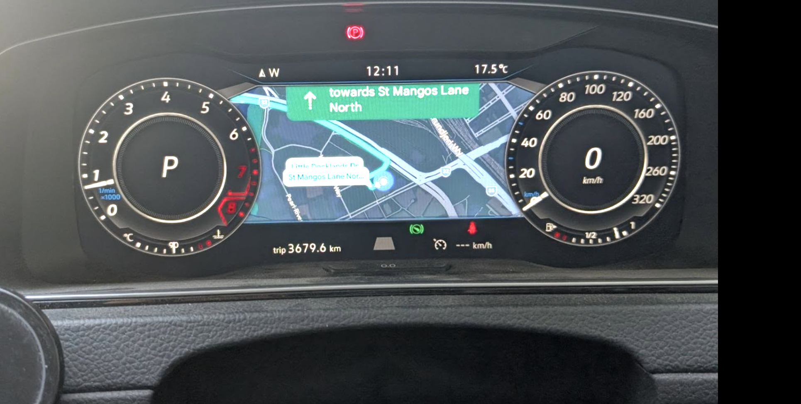

# MIB Cluster Map

[](https://buymeacoffee.com/macsinspace)
If this saves you a dealer visit, a [coffee](https://buymeacoffee.com/macsinspace) helps pay for the AI tokens that build it.

Puts your phone's map on the digital cluster of Volkswagen-group cars with a
Harman MIB2 / MIB2.5 High head unit ("Discover Pro").

| Phone | On the cluster |
|---|---|
| Android Auto | The Google Maps or Waze map, live. Working on many VW, SEAT, Skoda and Audi units |
| Android Auto, on firmware without a map profile | Turn-by-turn arrows, distance and track ([adi961's jar](https://github.com/adi961/mib2-android-auto-vc), [our fork](https://github.com/MacsInSpace/mib2-android-auto-vc)), on SEAT `P4708`/`P4709` and others |
| Apple CarPlay | The Apple Maps or Google Maps map, live, with the iPhone on a cable, on a growing list of cars ([CarPlay](docs/CarPlay.md)) |

**Will it work on my car?** You need a Harman MIB2/MIB2.5 High unit and a
digital cluster; the list of firmware that works is in the FAQ:
[Is my car supported?](docs/FAQ.md#your-car)

It installs from an SD card as a software update. No toolbox, laptop or
command line is needed. The installer checks the unit and installs what fits
it: the map, the arrows, or nothing. If nothing fits, it collects the files
needed to add your unit and installs nothing.

No VNC and no app on the phone. The phone sends its own cluster video stream,
and the head unit passes it to the cluster the same way it sends the built-in
VW map.



> [!CAUTION]
> This modifies system files on the head unit. A mistake can leave the phone
> connection, or the whole centre screen, not starting. Use it only on a car
> you own, keep the SD card, keep the battery charged, and never install or
> test while driving. No warranty of any kind. Read
> [Safety and recovery](docs/Install.md#safety-and-recovery) first.

## Install

1. **Make the SD card.** Format a 2 to 32 GB card as FAT32. Download the zip
   from [Releases](../../releases) and copy everything inside it to the card:

   ```text
   (SD card)
   ├── ClusterMap/
   ├── Custom/
   ├── metainfo2.txt
   └── Swdlautorun.txt
   ```

   Put it in **SD slot 1**, with the other slot empty.
2. **Run the update.** Engine running or a charger connected. On most units
   the card starts the update by itself within a couple of minutes
   (`Swdlautorun.txt`; the installer switches it off again when it
   finishes). If it does not, hold **MENU** until the service screen
   appears, then `Software updates/versions` > `Update` > the SD card >
   **`MIB Cluster Map`**. Let it finish (a "Version back documentation"
   screen at the end is normal: press `Cancel`), then hold the power button
   for ten seconds to reboot. Audi: the update menu is **BACK + upper-left**
   button and needs developer mode switched on in the head unit (5F). To
   stop the card starting on its own, rename `Swdlautorun.txt` to
   `_Swdlautorun.txt` (see the
   [Install guide](docs/Install.md#route-1-software-update)).
3. **Use it.** Plug in the phone, start a map, and switch the cluster to its
   map view with the steering wheel buttons. iPhone: once after installing,
   **Forget This Car** in its CarPlay settings and plug it in again.

### Settings

You do not need to edit anything: the map's size and the area kept clear of
the dials ship as `auto`, and the installer uses the values owners have
tested on your car. What it did is in `ClusterMap/update_result.txt` on the
card.

The update also adds a **ClusterMap** screen to the green engineering menu
(hold MENU > `Testmode` > `Green Developer Menu`): status, install, logs and
uninstall on the first screen, and three screens under it:

| Screen | What is there |
|---|---|
| `ClusterMapPicture` | Sharper map on/off, map always light / always dark / following the headlights (reboot after) |
| `ClusterMapOptions` | Hardware decoder on/off, keep the phone's map on/off (reconnect the phone), cluster map off/on (reboot after) |
| `ClusterMapSupport` | Files for porting, the turn-arrows switch, the hardware decoder check, performance figures in the log |

Anything else is a line in `ClusterMap/gal_dualscreen.conf`: change it, then
install again. Every setting, the values owners settled on, and the green
menu and SSH routes are in the [Install guide](docs/Install.md).

**Updating:** install the new release over the old one; your settings are
kept. **Uninstall:** green menu > `ClusterMap` > **Uninstall and restore
original state**, then reboot (or see the [FAQ](docs/FAQ.md#installing-and-updating)).

## Questions

The [FAQ](docs/FAQ.md) answers the ones that come up most: which cars work,
updating, where settings are, the map going when a route starts, sending
logs, what the cockpit can and cannot show, CarPlay sizes. Write in any
language. Other questions: [Discussions > Q&A](https://github.com/MacsInSpace/mib-cluster-map/discussions/categories/q-a).

## Where the project stands

The project began with one Golf, and that car has worked for a while. It now
reaches VW, SEAT, Skoda and Audi units thanks to owners who sent logs and
photos from their own cars. It is still maintained, but by one person with
a day job, so replies come a few times a week rather than daily, and
releases come when something is confirmed on a car.

What would help most now is people who work on the code directly: port your
own firmware in a fork (an AI assistant makes this far more approachable than
it sounds), fix what you find, and send a pull request. The
[Contributing guide](CONTRIBUTING.md) explains how, including a
step-by-step for porting your own car.

## Documentation

| Page | For |
|---|---|
| [FAQ](docs/FAQ.md) | Supported cars, updating, common problems, what it can and cannot do |
| [Install guide](docs/Install.md) | Install routes, the menu, settings, logs, safety and recovery, getting your unit added |
| [CarPlay](docs/CarPlay.md) | The CarPlay map: design, status, testing |
| [Development](docs/Development.md) | How it works, what was learned, adding a firmware, building |
| [Contributing](CONTRIBUTING.md) | Forks, pull requests, using an AI assistant, and porting your own car |

## Reporting a problem

Open an issue with your car, firmware train, what you did and what you saw.
Attach `update_result.txt` and the logs from green menu **Save logs to SD**,
saved before rebooting: without them most reports can't be looked into.
Attach them on the website: replies to GitHub emails lose attachments.
A fix of your own is even better, as a pull request.
Read them first: the system log can contain phone names and Bluetooth
addresses.

## Credits

- **chopinwong01**: [mhi2-android-auto-video-vc](https://github.com/chopinwong01/mhi2-android-auto-video-vc),
  the hook and player this project is forked from. Its design notes and
  development story stay there.
- **andrewleech** and **OneB1t**: VcMOSTRenderMqb, the cluster rendering path
  the player derives from.
- **jilleb**, **olli991** and contributors: the MQB Coding MIB2 Toolbox. Its
  `NavActiveIgnore.jar` (contributed by andrewleech) and the signed header of
  its update metadata are bundled unmodified under `thirdparty/` (MIT).
- **adi961**: mib2-android-auto-vc, the turn-arrows jar. Bundled under
  `thirdparty/` (MIT) as the arrows mode, built from
  [our maintained fork](https://github.com/MacsInSpace/mib2-android-auto-vc).
- **harman-f** ([mhi2_altscreen_carplay](https://github.com/harman-f/mhi2_altscreen_carplay))
  and **aberbic** ([Audi MHI2 AltScreen](https://github.com/aberbic/Audi-MHI2-Virtual-Cockpit-Altscreen-CarPlay-AndroidAuto)):
  the open CarPlay cluster work the CarPlay map builds on. harman-f's hook is
  included from source under GPL-3.0; the A7's steering-wheel zoom follows
  aberbic's (`changeMapZoomLevel` over loopback UDP).
- **Mr-MIBonk** ([M.I.B.](https://github.com/Mr-MIBonk/M.I.B._More-Incredible-Bash)):
  the `Swdlautorun.txt` trigger for installing without the service menu, and
  harman-f's Audi build of `NavActiveIgnore.jar` from it, bundled unmodified
  under `thirdparty/navactiveignore-audi/` (GPL-2.0) for the A6/A7 C7.5.
- **AMDFX60** ([Skoda fork](https://github.com/AMDFX60/mib-cluster-map)):
  the sharper-map full-frame mode, the fix for insets above 127 and the
  player priority setting, car-tested on his Superb and merged back here.
- **kkrvch** ([mib-std2-kombibridge](https://github.com/kkrvch/mib-std2-kombibridge)):
  the Android Auto 1.7 navigation decoder for MIB2 Standard. Its message
  layout and manoeuvre table are ported into `src/nav_translate.c`, with the
  author's kind permission, so the turn arrows can survive newer Android Auto
  versions. Thank you!
- **lito69**, **tulio150** and **DaniFR3**: car tests and porting files for
  the SEAT and the settings. Thanks also to lito69 for finding kombibridge and
  pointing us to it.
- **kamgurgul**, **wasimlhr** and **luka-dev**: the MHI2Q projects whose notes
  led to the connection-loop fix, and the open QNX toolchain.
- **FFmpeg**: H.264 decoding, statically linked, LGPL v2.1 or later.

## License

GPL-3.0, the same as upstream. See [LICENSE](LICENSE). Release packages
contain files built from this source plus the MIT-licensed items above. They
contain no Volkswagen, Harman or Apple program files.

Not affiliated with or endorsed by Volkswagen AG, Harman, Google or Apple.
Android Auto and Google Maps are trademarks of Google LLC; CarPlay and Apple
Maps are trademarks of Apple Inc.
